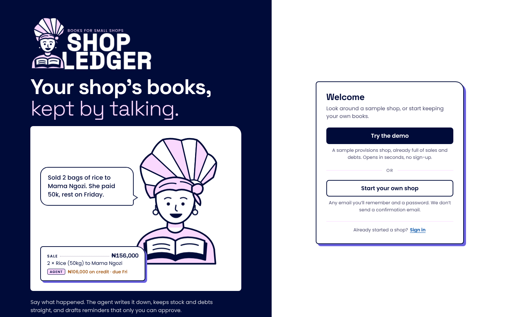
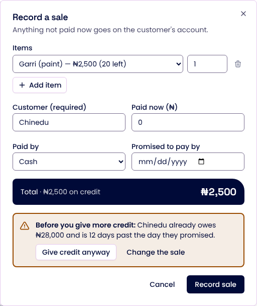

# Shop Ledger

**A small shop's books, kept by talking.** Built by Mag for the [Builder.io Agent-Native Hackathon](https://www.builder.io/hackathon) (Oct 27 – Nov 9, 2026).

**Live app: [shop-ledger-peach.vercel.app](https://shop-ledger-peach.vercel.app)** (tap **Try the demo**: a private sample shop opens in seconds, no sign-up)



Millions of shops in Nigeria and across Africa still keep sales, stock and "who owes what" in an exercise book. Credit ("put it on my account") is how many customers buy, and chasing it is awkward and easy to forget. Shop Ledger lets the owner say what happened, the way they would say it:

> "I sell 2 bag rice give Mama Ngozi, she pay 50k, remain go come Friday."

The agent can record the sale, take the bags out of stock, and put the unpaid balance on Mama Ngozi's account with Friday as the promised day. The Today screen then updates. Money and stock rules are enforced by the server; reminder drafts and typed old-balance imports need the owner's approval.

## What it does

| Feature | What happens |
| --- | --- |
| **Talk like you talk** | Type or speak in English, Nigerian Pidgin, Yoruba, Hausa or Igbo ("bashi", "gbese", "e don pay", "5k"). The agent records sales, payments, restocks and stock counts, and replies in the same language. |
| **Bring in old balances** | Type old debts or stock counts to the agent. It proposes entries for the owner to review and add from Today. |
| **Credit sense** | Before more credit goes out, the server checks the customer's own history: what they owe, how late they are, the most they've owed and paid back. A late payer or a sale over their limit is stopped with the reason, and goes through only when the owner says so. |
| **Evening close** | At 7 pm Lagos the day closes by itself: totals, who is late, and a WhatsApp reminder **draft** for each late payer. The owner can also close the day from Today or by asking. |
| **Learns your shop** | "Mama Pikin na Mama Ngozi", "one bag is the rice". Nicknames are saved and understood by every action afterwards. A nickname can belong to one customer or product only. |
| **Reminders the owner sends** | The agent drafts; only the owner can approve, and approving opens WhatsApp with the message ready to send from their own phone. |
| **Everything by hand too** | New sale, payments, restock, stock counts, voids, customers and products all have screens. Each entry shows who made it: you, the agent, the nightly job or sample data. |



## How it uses Agent-Native

| Framework piece | How Shop Ledger uses it |
| --- | --- |
| Actions as the single source of truth | 31 shop actions (`actions/*.ts`), defined once. The screens call them through the client hooks, the agent calls them as tools, and the CLI runs them (`pnpm action …`). `scripts/verify-rules.sh` proves the rules through the CLI. |
| Rules in actions, typed errors | `insufficient_stock`, `credit_needs_customer`, `overpayment`, `credit_check`, `nickname_taken`, `void_conflict`… The agent reads the error and explains it with the real figure instead of retrying with invented numbers. |
| Owner-only actions (`uiOnly`) | `approve-reminder`, `mark-reminder-sent` and `apply-notebook-import` run only for a signed-in person in the app. The agent, MCP clients, the CLI and raw HTTP get `403 ui_capability_required`. |
| Agent chat plugin | A system prompt covering the books' rules, credit sense, typed old balances, five languages, the evening close and nicknames, plus 16 tools loaded from the start. |
| UI → agent hand-off (`sendToAgentChat`) | The ask bar, voice input, and "Ask the agent" links. The two Today quick checks call their read-only actions directly. |
| Context awareness | Navigation state (`shopTab`, `customerId`), `view-screen` and `navigate`, so the agent knows what the owner is looking at and can move the screen. |
| SQL, migrations, access control | Drizzle schema with additive migrations (v1–v3); `ownerEmail`/`orgId` columns with the framework's `accessFilter`, so each account sees only its own shop. `agent-native doctor` is clean (no unscoped queries, no credentials from env). |
| Auth | Framework accounts. **Try the demo** uses the framework's own register and login endpoints to make a private throwaway account. |
| Jobs | The evening close rides on the framework's daily sweep (Vercel Cron at 18:00 UTC, `CRON_SECRET` checked with `readDeployCredentialEnv`). |
| Model choice | Supports configured providers, including Groq. The production provider and a complete agent run still need verification. |

## Rules the server enforces

These live in the actions, not in the prompt:

- Stock never goes below zero (conditional atomic update plus a database `CHECK`).
- Anything left unpaid needs a named customer; a payment can't exceed what is owed.
- Money is integer kobo; there are no floating-point naira.
- Entries are append-only. A mistake is **voided**: stock and balances are reversed and the entry stays, marked, for the audit trail. A void that would push stock or a balance below zero is refused.
- Names are matched carefully (real names, then nicknames, then partial matches). An ambiguous name is reported, never guessed.
- More credit to someone over 7 days late, or over their limit, needs the owner's explicit yes (`confirmCredit`).
- A typed old-balance import is only a draft until the owner applies it in the app.
- One open reminder per customer (partial unique index). Reminders follow a state machine: `draft → approved → sent`, or `dismissed`. The evening close drafts only for late payers who have no open reminder.
- Stock and balances are cached on rows *and* derivable from entries; `reconcile-ledger` recomputes both and lists any mismatch.

## Proof

| Check | Command | Last result (Oct 31, 2026) |
| --- | --- | --- |
| Unit tests: money, matching and nicknames, time, reminder machine | `pnpm exec vitest run` | 19/19 passed |
| Ledger rules against a real database | `bash scripts/verify-rules.sh` (dev server running) | 31/31 passed |
| Types | `pnpm typecheck` | clean |
| Framework guards (scoping, credentials, migrations…) | `pnpm agent-native:doctor` | clean |
| 7 pm hook | `curl` the sweep path with a wrong and a right cron secret | wrong → 401, nothing closed; right → 200, every active shop closed |
| Browser (Playwright) | welcome card, demo, sale, credit warning, typed import review, evening close, nicknames, reminders, phone width | passed locally on Oct 31; raw HTTP approval refused with 403 |

## Real vs. not yet verified

| Part | Status |
| --- | --- |
| Ledger, stock, credit sense, voids, reconciliation, nicknames, evening close | **Real**, verified locally on PGlite (Postgres) and deployed |
| Screens and the demo entry | **Real**, verified in a headless browser; live at the link above |
| Hosting | **Real**: Vercel (functions in `cle1`) + Neon Postgres |
| WhatsApp hand-off | **Real** `wa.me` link with the text filled in; the owner sends it from WhatsApp |
| The agent's conversations (local languages and tool choice) | A live run failed on Nov 1. A complete production agent run is not yet verified. |
| The 7 pm close on Vercel Cron | Configured; verified locally with the same request Vercel sends |

## Accounts

- **Try the demo** makes a private throwaway account that lives in that browser; each visitor gets their own sample shop.
- **Start your own shop** uses any email and a password. The books belong to that email, so signing in with it on another phone opens the same shop.
- No confirmation email is sent and there is no password reset yet (no email provider is configured).

## Run it

```bash
pnpm install          # if node-pty fails to build: npm_config_nodedir=$(dirname $(dirname $(which node))) pnpm install
pnpm dev              # open the printed URL and tap "Try the demo"
```

Set one AI key in `.env` (`GOOGLE_GENERATIVE_AI_API_KEY`, `OPENAI_API_KEY`, `ANTHROPIC_API_KEY` or `OPENROUTER_API_KEY`) to talk to the agent. The ledger, screens and rules work without one.

### Deploy (Vercel + Neon)

`vercel.json` builds with the Vercel preset, runs `pnpm migrate:production` on production deploys, and pins functions to `cle1` (next to the Neon database; keep them in the same region).

1. Import the GitHub repo into Vercel (framework: Other).
2. Vercel → Storage → add **Neon** and connect it; it sets `DATABASE_URL`.
3. Add environment variables: `BETTER_AUTH_SECRET` and `CRON_SECRET` (each `openssl rand -hex 32`), `AGENT_NATIVE_RELEASE_MIGRATIONS=1`, and one AI key.
4. Deploy and open the URL.

The daily sweep (and the evening close) runs at 18:00 UTC, which Vercel's free plan allows.

## Where things are

| Path | What |
| --- | --- |
| `actions/` | Every operation, shared by screens, agent and CLI |
| `server/lib/` | Ledger, credit sense, notebook imports, evening close, nicknames, matching, money and time |
| `server/plugins/` | Migrations, the agent's instructions and tools, branding |
| `server/middleware/evening-close.ts` | The 7 pm hook on the framework's sweep |
| `app/routes/shop*` and `app/components/shop/` | Today, Ledger, Customers, Stock and their parts |
| `scripts/verify-rules.sh` | The 31 rule checks |
| `docs/DEMO.md` | The demo script |

## Pre-existing work and what was built during the hackathon

- **Pre-existing:** the open-source [Agent-Native](https://github.com/BuilderIO/agent-native) Chat starter (`npx @agent-native/core create --template starter`): app shell, auth, agent chat, sidebar, UI primitives, and its `navigate`, `view-screen`, `run` and `provider-api-request` actions. The brand tokens and fonts (Space Grotesk, Poppins) come from Mag's own design system. Libraries are listed in `package.json`.
- **Built during the event (from Oct 31, 2026):** everything under `server/db`, `server/lib`, `server/middleware/evening-close.ts`, `server/plugins/db.ts`, the 31 shop actions, `app/routes/shop*`, `app/components/shop/`, `app/components/brand/`, the logo, illustrations and sign-in page, the theme changes in `app/global.css`, the agent instructions, the sample data, the tests and `scripts/verify-rules.sh`. See the git history.

All sample people, phone numbers and figures are invented.
